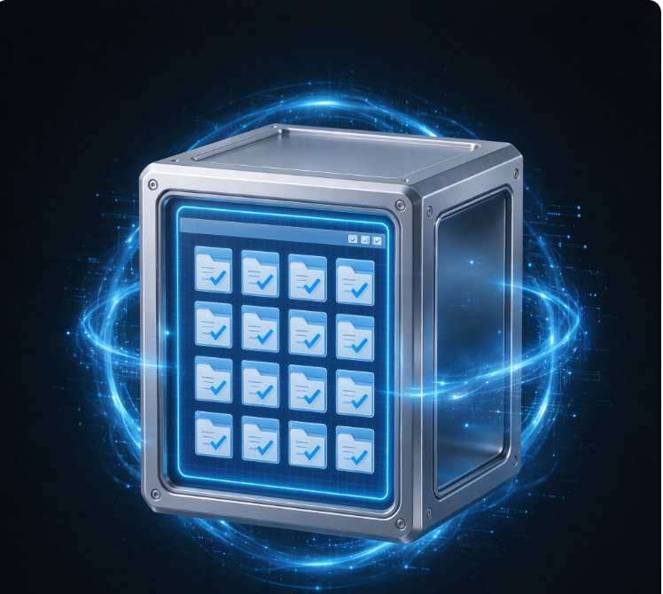

# DeskFence 桌面收纳

> 一个运行 Windows 桌面上的「格子式」文件收纳工具：把桌面图标拖进格子分类收纳，格子像桌面快捷方式一样贴在桌面层，不遮挡浏览器 / IDE / 文件夹，任务栏「显示桌面」和 `Win+D` 也不会消失。



---

## 功能特性

### 收纳格子

- **拖入即收纳**：从桌面或资源管理器把文件 / 文件夹拖进格子，文件会**实体移动**到收纳目录（原位置不再保留）；重名自动加 `(1)(2)` 后缀
- **系统原生右键菜单**：格子内每个图标右键调用 Windows `IContextMenu`，与桌面/资源管理器一致——打开、复制、剪切、重命名、属性、删除等；删除/剪切后自动清理失效条目
- **拖拽排序**：格子内拖动重排，也可在不同格子之间拖动迁移
- **视图模式**：图标视图 / 列表视图
- **排序方式**：手动 / 按名称 / 按类型
- **17 种格子配色**：深灰、深蓝、深绿、深紫、深红、深橙、深青、浅灰、米白、浅蓝、浅绿、浅粉、浅紫、浅黄、橙色、青色、翠绿、玫红
- **11 种边框样式**：简约描边、大圆角、直角、加粗、发光、霓虹、顶部彩条、玻璃、角落装饰、虚线、无边框
- **标题栏交互**：拖动移动窗口、双击标题重命名、折叠 / 展开、锁定 / 解锁
- **四边四角缩放**：沿窗口边缘和角落拖动调整大小
- **底部工具栏**：排序下拉、视图切换、项数统计、右下角缩放手柄

### 便签

- 富文本便签，7 种预设颜色 + 自定义取色
- 独立拖动条移动，支持缩放、右键改色

### 托盘与设置

- **托盘菜单**：新建格子、新建便签、设置中心、隐藏/显示全部、退出
- **双击托盘图标**：一键显示/隐藏全部格子与便签
- **设置中心**：显示全部、开机自启动、格子不透明度（60–250）、图标大小（32/40/48）、数据目录迁移

### 稳定性设计

- **桌面同层级显示**：格子挂成桌面窗口的子窗口（与桌面图标同层），位于所有普通应用窗口**下方**，不抢焦点、不进 `Alt+Tab`
- **`Win+D` / 显示桌面不消失**，且新建格子会立刻抬到旧格子之上，不会被遮挡
- **冷启动自修复**：启动后重放一次窗口事件分发，确保首次加载图标就有 hover 高亮和选中态
- **Explorer 重启自愈**：守护定时器每 3 秒检查桌面挂载，桌面层重建后自动重新挂回
- **单实例**：已有实例运行时新实例直接退出，避免多进程互相覆盖配置
- **配置安全**：每次保存先备份上一版为 `config.json.bak`；配置丢失但收纳目录还在时，自动为每个孤儿目录重建格子
- **开机自启自愈**：配置开启自启但启动项被删或 exe 换位置，启动时自动补写

---

## 目录结构

```
deskfence/
├── main.py          # 程序入口：日志、单实例、QApplication、自启自检
├── common.py        # 公共常量、配色/边框、桌面层级挂载、文件图标、Win32 hit test
├── storage.py       # 文件实体移动：拖入收纳 / 放回桌面 / 重名处理
├── fence.py         # 收纳格子：图标项、标题栏、工具栏、缩放、排序、右键菜单
├── note.py          # 便签
├── settings.py      # 设置中心 + 开机自启（注册表 Run）+ 数据目录迁移
├── manager.py       # 托盘、格子/便签管理、配置持久化
├── shellmenu.py     # 调用 Windows 原生文件右键菜单（COM IContextMenu）
├── syd.png          # 应用图标
├── config.json      # 默认配置模板
├── rebuild.ps1      # 打包脚本（备份数据 + PyInstaller + 复制到 release）
├── packaging/
│   └── app.ico      # exe 图标
└── release/
    └── DeskFence.exe  # 打包产物
```

---

## 运行与打包

### 环境要求

- Windows 10 / 11
- Python 3.13
- 依赖：`PySide6`、`pywin32`
- 打包：`PyInstaller`

### 源码运行

```powershell
pip install PySide6 pywin32
py main.py
```

带 `--smoke` 参数启动后 1.5 秒自动退出，用于冒烟测试：

```powershell
py main.py --smoke
```

### 打包 exe

`rebuild.ps1` 会先备份数据目录，再用 PyInstaller 单文件模式打包，最后复制到 `release\DeskFence.exe`：

```powershell
powershell -ExecutionPolicy Bypass -File .\rebuild.ps1
```

脚本内的数据备份路径、构建临时目录等为示例值，请按自己机器修改后再执行。

打包参数要点：

- `--onefile --windowed`：单文件、无控制台
- `--add-data "syd.png;."`：内置图标
- `--exclude-module`：排除 WebEngine、Quick、Qml、Multimedia、Sql、Test 等未使用模块，减小体积

---

## 数据与配置

### 数据目录

程序按以下优先级解析数据目录：

1. 注册表 `HKCU\Software\DeskFence\DataDir`
2. 默认位置的 `data_dir.txt` marker 文件
3. 默认位置 `config.json` 里的 `settings.data_dir`
4. 默认位置

其中「默认位置」为：

- **打包运行**：`%APPDATA%\DeskFence`
- **源码运行**：`main.py` 所在目录

可在设置中心 → 数据目录 → 更改…，选择迁移（复制过去）或切换（使用目标已有配置）。

### 配置结构

`config.json` 示例：

```json
{
  "settings": {
    "autostart": false,
    "fence_alpha": 170,
    "icon_size": 40
  },
  "all_visible": true,
  "fences": [
    {
      "id": "6fec74a6",
      "name": "默认格子",
      "color": "#191c22",
      "frame": "简约描边",
      "sort": "manual",
      "view": "icon",
      "locked": false,
      "x": 120, "y": 120, "w": 360, "h": 300,
      "collapsed": false,
      "items": []
    }
  ],
  "notes": []
}
```

- `settings`：全局设置（自启、不透明度、图标大小）
- `all_visible`：全局显示状态
- `fences[]`：每个格子的名称、配色、边框、排序、视图、锁定、位置尺寸、条目路径
- `notes[]`：便签的富文本内容、位置尺寸、颜色
- `storage/<格子 id>/`：该格子收纳的文件实体

### 日志

- 启动日志：`%APPDATA%\DeskFence\startup.log`（超过 300 KB 自动清理）
- 排查启动异常、自启失败先看这个文件

---

## 使用提示

| 操作 | 方式 |
|---|---|
| 收进格子 | 把桌面 / 资源管理器里的文件拖到格子里 |
| 取出放回桌面 | 在格子里把图标拖出到桌面，或右键系统菜单「剪切」后粘贴 |
| 改格子名字 | 双击标题栏文字，输入后回车 |
| 折叠格子 | 双击标题栏空白处，或点标题栏 `▾/▸` 按钮 |
| 锁定格子 | 点标题栏 🔒/🔓 按钮，锁定后不可拖动 |
| 改配色 / 边框 | 格子空白处右键 → 格子颜色 / 边框样式 |
| 排序 / 视图 | 格子底部工具栏 |
| 显示/隐藏全部 | 双击托盘图标，或托盘菜单 |
| 退出 | 托盘菜单 → 退出 |

> 格子位于桌面图标层，平时在浏览器、IDE、文件夹等窗口下方。需要操作被挡住的桌面内容时，正常切到桌面（`Win+D`）即可。

---

## 实现说明

### 桌面层级

格子 / 便签是无边框 `Qt.Tool` 窗口，通过 Qt 原生 `windowHandle().setParent()` 挂到持有 `SHELLDLL_DefView` 的 `WorkerW`（找不到则 `Progman`）成为子窗口，天然获得「桌面之上、应用窗口之下」的层级。

关键点：

- 必须用 **Qt 的 `setParent`**，不能用 Win32 `SetParent`。否则 Qt 仍认为窗口是顶层，冷启动时坐标映射与鼠标命中会错乱
- 桌面窗口位于 `(0,0)`，子窗口坐标与屏幕坐标一致，位置不会偏移
- 退出前必须 `setParent(None)` 解除挂载，否则 `QWindow.fromWinId` 包装的桌面父窗口会让 Qt 事件循环无法退出
- 新建 / 恢复显示时用 `SetWindowPos(HWND_TOP, SWP_NOMOVE|SWP_NOSIZE|SWP_NOACTIVATE)` 抬到桌面子窗口顶部，不抢焦点

系统右键菜单通过 `ctypes` 直接调用 Shell COM 的 `IShellFolder::GetUIObjectOf` / `IContextMenu`，用规范动词（verb）执行命令，不依赖第三方库。

---

## 许可证

自用工具，按需使用。
